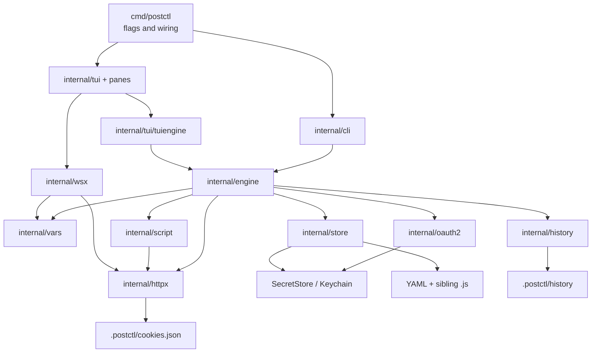

# Architecture

postctl has two front ends over one execution core. The TUI turns keys into
typed Bubble Tea messages; the CLI parses flags and prints linear output. Both
hand model snapshots to the engine, which owns ordering. Lower packages do one
job and do not know how their result is presented.

Arrows are allowed compile-time dependency directions. `model` is omitted
because almost every layer may import its pure types; `ui` is presentation-only.
`cli` and TUI subpackages may also consume result contracts from `httpx`,
`history`, and `report`.

The direct-import audit (`go list` over `cmd/postctl` and `internal/...`) found
no boundary violation: `engine` imports no Charm or TUI package, and storage,
HTTP, variables, scripting, history, and the domain model import no TUI.
Two deliberate cross-layer edges are easy to misread: `oauth2` imports
`httpx` for an interface assertion and token-endpoint calls, and the root
`internal/tui` package imports `engine` for runner event contracts. Neither
reverses control into presentation.

## Package map

| Package | Purpose | Key types | Main entry points | Called by |
| --- | --- | --- | --- | --- |
| `cmd/postctl` | process flags and composition | `lazyEngine` | `run`, `openUI`, `wireEditors` | OS |
| `internal/model` | pure persisted domain | `Workspace`, `Collection`, `Request`, `Auth` | `NewRequest`, clone/validate methods | every data layer |
| `internal/store` | discovery, YAML/JS, locks, secrets, state | `Store`, `Location`, `SecretStore` | `Discover`, `Open`, `Init`, `Load`, `LoadLenient`, `Save` | command, CLI, engine, TUI backend |
| `internal/vars` | scopes and template resolution | `Scope`, `Store`, `MemStore`, `Change` | `New`, `ResolveRequest` | engine, script, curl, WebSocket |
| `internal/httpx` | auth, body encoding, cookies, transport/timing | `Sender`, `Response`, `Options`, `CookieJar` | `NewClient`, `Client.Send`, `NewCookieJar` | engine, script, WebSocket |
| `internal/oauth2` | grants, loopback, token secret access | `Source`, `FetchOptions` | `Fetch`, `NewSource`, `Source.Save` | request editor, engine/httpx |
| `internal/script` | goja sandbox and `pm.*` bridge | `Input`, `Result`, `ScriptError` | `Run` | engine |
| `internal/engine` | send and collection-run ordering | `Engine`, `SendInput`, `Outcome`, `RunInput` | `New`, `Engine.Send`, `Engine.RunAsync` | CLI and TUI adapter |
| `internal/history` | bounded redacted JSONL log | `Log`, `Entry`, `Redactor` | `Open`, `Log.Append`, `NewRedactor` | engine, CLI, viewers |
| `internal/report` | JSON/JUnit run consumers | `Reporter`, `Options` | `NewJSON`, `NewJUnit`, `Write` | CLI and TUI runner |
| `internal/wsx` | WebSocket prepare/connect | `Prepared`, `Conn` | `Prepare`, `Dial` | WebSocket pane |
| `internal/tui` | Bubble Tea shell, routing, reload and send queue | `Options`, `Backend`, `Sender`, `SendResult` | `Run`, `New`, `NewStoreBackend` | command |
| `internal/tui/request` | HTTP editor | `Pane`, `Deps` | `New`, `Factory` | TUI shell factory |
| `internal/tui/response` | response/tests/console/timeline | `Pane` | `New` | TUI shell factory |
| `internal/tui/runner` | live runner screen | `Model`, `Deps` | `New`, `Factory` | TUI screen routing |
| `internal/importer/postman*` | stable conversion and local cache extraction | `Document`, `Report`, `Coverage` | `Convert`, `MergeDocuments`, `Extract` | import command |

## Contracts that hold the layers together

- `internal/httpx/types.go` `Sender` accepts a fully resolved
  `model.Request`. `Response` separates normal HTTP statuses from transport
  errors and carries `Timings` plus the exact `SentRequest`.
- `internal/vars/scope.go` `Store` is live typed state. Scope precedence is
  global < collection < folder (private read layer) < environment < data <
  local. `Changes` is the R3 persistence delta, not a model snapshot.
- `internal/tui/send.go` `Sender` is synchronous from the implementation's
  point of view but always called in a command. `SendRequest`, `SendStep`, and
  `SendResult` are the only send data the shell and panes exchange.
- `internal/store/secrets.go` `SecretStore` is concurrent-safe
  `Get`/`Set`/`Delete`. `Keychain` is production; `MemorySecrets` is the test
  fake; `CachingSecrets` caches reads and invalidates writes.
- `internal/store/store.go` `Store.Load` is strict for CLI, while
  `Store.LoadLenient` returns readable data plus `FileError`s for the TUI.
  Writers in `internal/store/save.go` include whole-node saves and narrow
  `Store.UpdateCollectionVariables`, `Store.UpdateEnvironmentVariables`, and
  `Store.UpdateGlobalsVariables`.

## Process wiring

`cmd/postctl/main.go` `run` parses global flags and dispatches. With no
subcommand, `openUI` discovers a workspace and builds a lazy store backend.
`cmd/postctl/wire.go` `wireEditors` installs pane/screen factories, an
OAuth-aware request pane, runner, history and WebSocket pane. `lazyEngine.get`
opens one shared store and constructs the HTTP client, OAuth source, cookie
jar, history, and engine only when the first feature needs them. Setting
`POSTCTL_FAKE_SENDER=1` replaces only HTTP sends with the deterministic fake;
the real shell, editor, routing, and response rendering still run.

## Concurrency and cancellation

Bubble Tea calls `Update` and `View` serially. Effects are `tea.Cmd`s:
`internal/tui/app.go` `loadCmd` loads files, while
`internal/tui/sendrun.go` `startSend` snapshots models and runs the blocking
sender. A mutex-protected queue converts progress callbacks into ordered tea
messages. Escape cancels the per-request context; quit cancels every flight.

Engine sends are independently concurrent. Scripts have watchdogs and the HTTP
request carries the same context. Runner `Engine.RunAsync` owns one goroutine
and emits buffered typed events. All store writers serialize through the
per-root mutex plus advisory flock in `internal/store/lock.go`; narrow variable
updates re-read under that lock. History has its own append lock.

## Errors and exits

Expected send failures live in `Outcome.Err` or `Outcome.ScriptError`; only
invalid engine input is returned as a Go error. HTTP 4xx/5xx is a response, not
a transport error. Lenient TUI reload keeps the last good model if the
workspace root fails. CLI exit codes are 0 success, 1 test/script failure, 2
transport/request/import-partial failure, and 3 usage/configuration failure
(`internal/cli/cli.go` `ExitOK` through `ExitUsage`).

## State on disk

Versionable state is `postctl.yaml`, `globals.yaml`,
`environments/*.yaml`, and `collections/**` YAML with sibling `.js` scripts.
Local state is under gitignored `.postctl/`: `state.yaml`, `cookies.json`,
`store.lock`, and `history/history.jsonl`. Secret variable values and OAuth
token strings are outside the tree in macOS Keychain; files contain only
`secretRef`. See [storage flow](flows/storage.md) for write and reload details.
