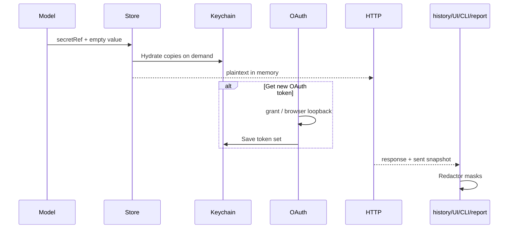

# Flow: authentication, secrets and masking

1. `model.Auth` supports inherit, none, bearer, basic, API key, digest, OAuth2,
   AWS v4, Hawk, NTLM and unsupported-preserved auth. Nil request/folder auth
   inherits; collection nil means none.
   `internal/vars/resolve.go` `ResolveRequest` walks collection → folders →
   request and places one flattened auth block on the resolved clone.

2. `internal/httpx/client.go` `Client.Send` calls auth application after body
   encoding, because signatures may cover encoded data. OAuth2 obtains a token
   through `httpx.TokenSource`; digest may retry once after a challenge.
   Redirect policy strips Authorization across hosts unless explicitly
   configured to retain it.

3. A `model.Variable` with `VarSecret` holds plaintext only in memory and a
   `SecretRef` on disk. OAuth token strings are excluded from YAML and stored
   together under `oauth2/<owner-id>`. Literal auth fields remain literal by
   design; contributors should use variable references, while importer D2
   rewrites imported credentials automatically.

4. `internal/store/keychain.go` `Keychain.Get`, `Keychain.Set`, and
   `Keychain.Delete` invoke `/usr/bin/security` without a shell. Values are
   base64 encoded and passed through stdin, never argv.
   `internal/store/store.go` `newStore` wraps the configured implementation in
   `internal/store/secrets.go` `NewCachingSecrets`: successful/missing reads
   are process-cached; set/delete invalidate that ref.

5. `Store.Load` never accesses Keychain. Execution clones models and calls
   `Store.HydrateVariables`/`Store.HydrateAuth`; editor reveal commands hydrate
   only the selected copy. Save copies the model, writes changed plaintext to
   `SecretStore`, then serializes only refs. Tests inject `MemorySecrets`.

6. `internal/oauth2/fetch.go` `Fetch` implements client credentials, password,
   authorization code, authorization code + PKCE, implicit, and explicit
   refresh. It does not persist. Browser grants use
   `internal/oauth2/loopback.go` `listen` on `127.0.0.1`, random path/state,
   constant-time state comparison, bounded request sizes and no-store callback
   pages. PKCE creates a verifier when absent.

7. The request editor's explicit “Get new token” path calls
   `internal/oauth2/source.go` `Source.Request`, then `Source.Save`, which writes
   strings to Keychain and leaves metadata/ref for workspace save.
   Normal `Source.Token` only returns a stored, unexpired token; it never opens
   a browser or refreshes automatically. A send without one gets an actionable
   `OAuthTokenMissingError`.

8. The engine builds `internal/history/redact.go` `Redactor` from hydrated
   secret variables, newly written secret values, and OAuth token strings. It
   also registers the configured API-key field name. Masking recognizes
   credential-shaped header/query/form/JSON keys, URL passwords, and known
   values. Values shorter than four characters are masked only as whole values
   to avoid destroying ordinary text.

9. Masking is applied before persistence or external presentation:
   `internal/engine/record.go` `session.record` for history;
   `internal/tui/response/mask.go` for sensitive-name policy and the response
   pane's redactor-backed views for headers, tests, console and errors;
   `internal/tui/response/timeline.go` `RenderTimeline` for wire details;
   `internal/cli/send.go` `app.maskBody` and related helpers for
   CLI/curl; runner reporter `Options.Mask`; and pager stdin. The live response
   remains unmodified so tests and explicit reveal can use it.

10. Reveal paths are deliberate and local: environment/request editor reveal
    hydrates in a command, response Timeline reveal toggles a display snapshot,
    CLI `env show --reveal` confirms on a TTY, curl requires
    `--with-secrets`, and pager still receives masked content. History is
    irreversibly redacted, so it cannot reveal an old credential.

Extension points are `SecretStore`, `httpx.TokenSource`, new typed auth
application, and redactor sensitive-name rules. Any new output boundary must
receive the outcome redactor or a mask callback; adding a reveal path requires
an explicit user action and a leak-sweep test.
