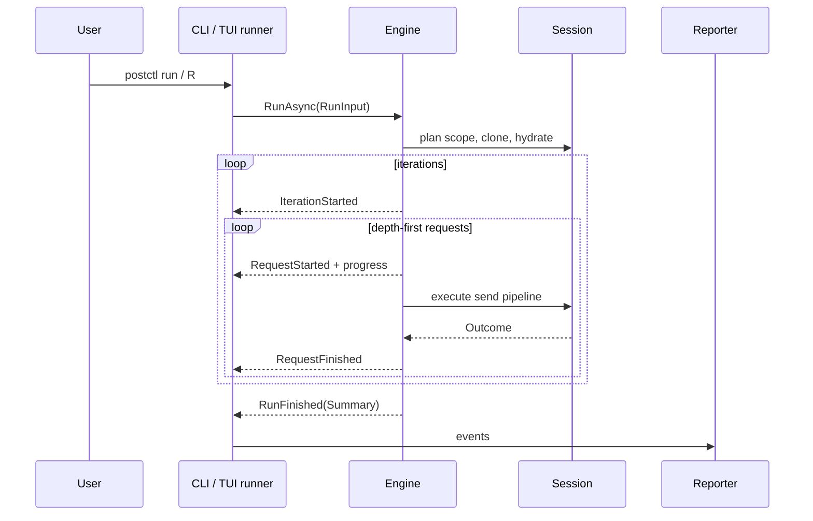

# Flow: collection runner

1. CLI `internal/cli/run.go` `runRun` parses collection/folder path,
   environment, `--var`, CSV/JSON data, count, delay, bail, timeout, history
   and reporters. It calls `internal/engine/data.go` `LoadDataFile`, clones the
   collection, constructs reporters, and invokes `Engine.RunAsync`.

2. TUI `internal/tui/runner/runner.go` `Model.Update` gathers the same
   `engine.RunInput` from its setup form. The runner dependency is wired through
   `internal/tui/tuiengine/runner.go` `Runner.RunAsync`. Events return as
   Bubble Tea messages and update live rows, details, summary and export state;
   Escape cancels its context.

3. `internal/engine/run.go` `Engine.RunAsync` calls `Engine.planRun` before
   starting a goroutine. Planning creates one hydrated engine session, resolves
   collection or folder scope, walks requests depth-first in display order,
   applies `OnlyRequests`, and chooses iteration count: explicit count, else
   data-row count, else one.

4. `runPlan.seedIteration` clears Local and Data scopes, installs the current
   row (reused modulo row count), then re-seeds CLI locals. Collection,
   environment and globals stay live for the entire run, so script changes are
   visible to later requests. Unless `NoPersist` is set, each request
   patch-persists those changes under the store lock.

5. `runPlan.run` emits `RunStarted`, iteration events, request start/progress/
   finish events, and finally `RunFinished`. A normal request uses the exact
   send pipeline in `session.execute`. WebSocket requests are emitted as
   skipped with `engine.WebSocketSkipReason`; they run no scripts and do not
   count as attempted requests or failures.

6. `pm.execution.setNextRequest(name)` sets `Outcome.NextRequest`. The runner
   searches names before IDs and jumps within the selected scope/filter.
   `setNextRequest(null)` stops with `StopNextNull`; a missing/out-of-scope
   target records a script failure and `StopNextMissing`. Loops are allowed
   until cancellation or another stop rule.

7. `Bail` stops after any failing test, script, or transport outcome.
   `StopOnScriptError` is narrower. A pre-request script failure skips only
   that request unless a stop option applies. Delay occurs between HTTP
   requests, never before the first; context cancellation interrupts delay and
   in-flight work and produces `StopCancelled`.

8. `internal/engine/run.go` `tally` builds `RunSummary`: requests/skips,
   tests, script/transport failures, timing and stop reason. Failure text is
   passed through each outcome redactor. Transport errors take exit code 2;
   tests/scripts code 1; clean runs code 0.

9. CLI sends every event to reporters. `internal/cli/reporter_cli.go`
   `cliReporter.Event` renders human progress, while
   `internal/report/json.go` `NewJSON` writes event JSON and
   `internal/report/junit.go` `NewJUnit` accumulates JUnit XML. `--json` is
   NDJSON. TUI uses the same event stream and `internal/report` exporters.
   Reporter `Options.Mask` is the final defense for failures and assertions.

Extension points are `engine.RunEvent`, the runner interface, and
`internal/report/report.go` `Reporter`. New reporters should consume events,
remain streaming where possible, apply `Options.Mask` to user-controlled text,
and avoid reading the workspace or Keychain themselves.
