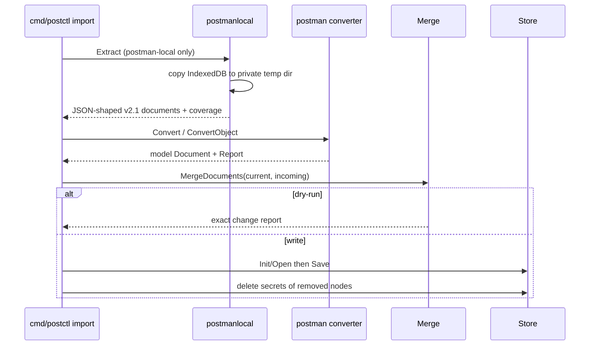

# Flow: importing Postman data

1. `cmd/postctl/import.go` `runImport` selects `postman` or
   `postman-local`, parses workspace, dry-run, JSON report, environment/
   globals paths, partition and `--keep-literal-secrets`, then dispatches.
   File import recursively collects JSON files and never treats their content
   as log-safe.

2. Standard files are read and passed to
   `internal/importer/postman/converter.go` `Convert`. The converter accepts
   Collection v2.0/v2.1, environment and globals documents, preserves stable
   Postman IDs and unknown fields, and maps folders, requests, auth, bodies,
   variables, examples and scripts into `internal/model`.

3. Local import calls `internal/importer/postmanlocal/locate.go` `Locate`, then
   `internal/importer/postmanlocal/extract.go` `Extract`. Extraction selects
   the active/configured Postman partition, copies the entire IndexedDB
   directory to a mode-0700 temporary location, and opens only that copy.
   Postman can remain open; the source database is never mutated.

4. The local extractor scans LevelDB read-only with Chromium's `idb_cmp1`
   comparator, decodes IndexedDB/Blink/V8 envelopes (including Snappy and blob
   indirection), and reconstructs ordered collections, environments and a
   globals session. It returns coverage counts and unresolved/missing-body
   counts, never values. The cache may be incomplete, so a Postman file export
   remains the fallback.

5. `Extract` intentionally normalizes decoded values to JSON-shaped Go values:
   `map[string]any`, `[]any`, strings, numbers, booleans and nil. It emits
   standard v2.1-shaped `postmanlocal.Document`s. `runImport` feeds each through
   `internal/importer/postman/converter.go` `ConvertObject`, keeping reverse-
   engineered storage details outside the stable converter.

6. Conversion applies decision D2 in
   `internal/importer/postman/secrets.go` `moveAuthSecrets`: credential
   literals become generated secret collection variables and auth fields
   become `{{variable}}` references; Postman secret environment values become
   `model.VarSecret`. OAuth token strings remain token secrets. The opt-out
   keeps literal auth credentials. Reports contain counts and names, not
   values.

7. `cmd/postctl/import.go` `openImportWorkspace` discovers or prepares the
   target and strictly loads an existing workspace. The production secret
   store is Keychain; tests replace the `importSecrets` factory with
   `store.MemorySecrets`, so they never access a developer's Keychain.

8. `internal/importer/postman/import.go` `MergeDocuments` overwrites
   collections, environments and globals by stable ID. Imported fields and
   children replace the old node wholesale; unrelated top-level documents are
   kept. A locally fetched OAuth token is carried to an incoming matching node
   that has no token. The YAML/script fingerprint produces exact added,
   changed and removed lists without reading Keychain values.

9. `--dry-run` stops after that same merge and report path, so no workspace or
   Keychain write occurs. A real import calls
   `internal/store/save.go` `Store.Save` under the workspace lock, atomically
   writes YAML/sibling scripts, and moves in-memory secret values to Keychain.
   `Store.DeleteRemovedSecrets` cleans only refs belonging to replaced nodes
   that no longer exist. `.postctl/` is never part of the merge.

Extension points are the local decoder's supported V8 tags, the JSON-shaped
document boundary, converter mappings/options, static script lint, and report
warnings. Keep new extraction logic privacy-safe and keep format-specific
values out of `internal/model`.
