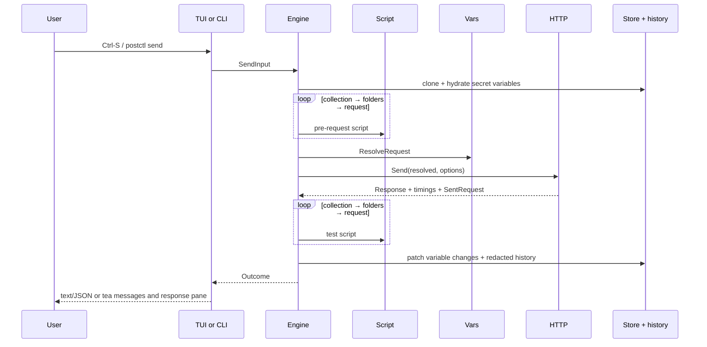

# Flow: send one HTTP request

## Entry paths

1. In the TUI, `internal/tui/request/keys.go` `Pane.onKey` maps Ctrl-S and
   Ctrl-Enter to `internal/tui/request/sendflow.go` `Pane.sendNow`, which
   returns `tui.SendRequestMsg`. `internal/tui/app.go` `app.Update` calls
   `internal/tui/sendrun.go` `app.startSend`. It clones the collection,
   request, and environment, creates a cancellable flight, and invokes the
   `tui.Sender` inside a Bubble Tea command. Progress enters `Update` through
   an ordered queue.

2. The adapter `internal/tui/tuiengine/tuiengine.go` `Sender.Send` maps
   `tui.SendRequest` to `engine.SendInput` and later maps `engine.Outcome` to
   `tui.SendResult`. `cmd/postctl/wire.go` `lazyEngine.get` constructs the real
   engine only on this first use.

3. In the CLI, `internal/cli/send.go` `runSend` parses the request path,
   environment, `--var`, output and script/history switches. It strictly loads
   the workspace through `internal/cli/workspace.go` `app.open`, builds the
   same engine with `app.newEngine`, calls `Engine.Send`, prints masked output,
   and maps the outcome to exit 0, 1, or 2.

## Engine pipeline

4. `internal/engine/send.go` `Engine.Send` validates input and calls
   `internal/engine/session.go` `Engine.newSession`. It deep-clones collection,
   environment, and globals, then uses `Store.HydrateVariables` on those
   copies. Missing refs become warnings; a Keychain error prevents an
   unfaithful send. Folder variables are hydrated too.

5. The session creates `vars.MemStore`. Resolution precedence is global <
   collection < folder (outer to inner) < environment < data < local.
   CLI `--var` and `pm.variables.set` are local. Before each request,
   `session.execute` calls `MemStore.SetFolderVariables`, because a collection
   run may cross folders.

6. `session.scriptsFor` selects enabled pre-request scripts in collection,
   folder, request order. Each call to `internal/script/script.go` `Run` sees
   the unresolved, cloned request plus the live `vars.Store`. It may mutate
   `pm.request`, variables, cookies, set the next request, or skip. A pre-script
   error stops before HTTP; skip persists variable changes but creates no
   history entry.

7. `internal/vars/resolve.go` `ResolveRequest` substitutes URL, headers, body,
   auth and settings, and flattens inherited auth. Unknown URL references stay
   visible and become warnings. The resulting request may contain plaintext
   secrets and must never be logged.

8. `internal/httpx/client.go` `Client.Send` encodes the body, applies auth,
   cookies and defaults, then sends with `net/http`. OAuth auth calls
   `internal/oauth2/source.go` `Source.Token`; it reads only a usable stored
   token and never starts a browser flow. The response contains decoded bytes,
   wire sizes, redirect hops, `httptrace` phase timings, and the final
   `httpx.SentRequest`. HTTP error statuses are normal responses.

9. Test scripts run in the same collection → folders → request order with
   `pm.response`. Tests, console lines and script errors accumulate in the
   outcome. A failing test does not discard the response.

10. `internal/engine/persist.go` `session.persist` takes `vars.Change` deltas
    for environment, collection and globals. The narrow store
    `Update*Variables` methods re-read the current file under the workspace
    mutex plus `.postctl/store.lock`, apply only changed keys, move changed
    secret values to Keychain, and atomically rename. Local/data/folder layers
    are never persisted. Save failures are warnings.

11. `internal/engine/record.go` `session.record` creates history from the wire
    snapshot (or resolved request on transport failure). `history.Redactor`
    masks credential-shaped fields, URL userinfo, and every hydrated or newly
    written secret before `Log.Append`. Skips, failed pre-scripts, and cancelled
    sends are not recorded.

12. TUI progress/result values become `SendProgressMsg` and `SendResultMsg`.
    `app.onSendEvents` broadcasts them and focuses the response pane on narrow
    layouts. `internal/tui/response/pane.go` `Pane.Update` stores a display
    snapshot; `Pane.View` renders response, tests, console and timeline through
    the outcome redactor. CLI text/JSON similarly masks headers, URLs, bodies,
    console and failures before writing.

Extension points are `httpx.Sender`, `httpx.TokenSource`, `script.CookieAccess`,
the store and clock fields in `engine.Config`, `tui.Sender`, and reporter/output
adapters. Cancellation is one context from Esc/SIGINT through scripts,
`pm.sendRequest`, OAuth token reads, and `net/http`.
