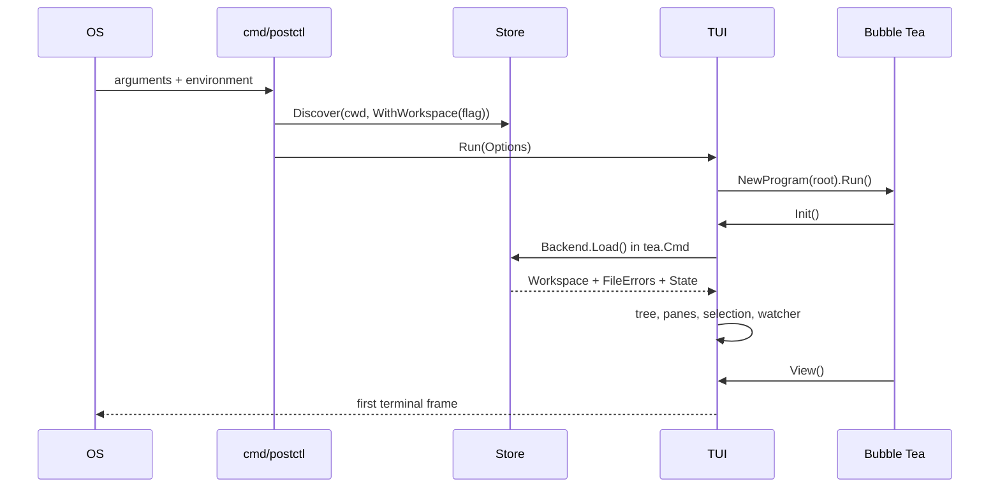

# Flow: process startup to first frame

1. `cmd/postctl/main.go` `main` calls `run` under a signal-cancelled context.
   `run` parses `--workspace`/`-w`, `--accessible`, `--ascii`, help, and
   version before dispatching a subcommand. With no subcommand it calls
   `openUI`. `NO_COLOR`, `POSTCTL_ACCESSIBLE`, and `POSTCTL_ASCII` are applied
   by `internal/tui/run.go` `ApplyEnv`.

2. `openUI` gets cwd and calls `internal/store/discover.go` `Discover`.
   Precedence is explicit `WithWorkspace` (the flag), `POSTCTL_WORKSPACE`, the
   nearest `postctl.yaml` found walking toward the filesystem root, then
   `GlobalDir`: `POSTCTL_HOME`, absolute `XDG_CONFIG_HOME/postctl`, or
   `~/.config/postctl`. A forced or global location may be uninitialized.

3. `openUI` constructs `internal/tui/backend.go` `NewStoreBackend` with a
   `store.Keychain`. The backend deliberately opens lazily: an uninitialized
   location must reach the first-run screen rather than fail composition.
   `cmd/postctl/wire.go` `wireEditors` injects real pane/screen factories and
   either `lazySender` or the `POSTCTL_FAKE_SENDER=1` fake.

4. `internal/tui/run.go` `Run` starts Bubble Tea with
   `internal/tui/app.go` `newApp`. That function builds the theme, key registry,
   tree, pane instances and responsive geometry without I/O.

5. Bubble Tea invokes `app.Init`. It batches a background-color query,
   delayed spinner, and `app.loadCmd`. The command calls
   `storeBackend.Load`, which opens the store and uses
   `internal/store/store.go` `Store.LoadLenient`. Malformed child files become
   `[]*store.FileError`; only an unreadable workspace manifest is fatal.
   Loading does **not** hydrate Keychain values.

6. `app.onLoaded` installs the `model.Workspace`, problems, active environment
   and persisted fold state. It broadcasts `WorkspaceReloadedMsg`,
   `EnvironmentChangedMsg`, and selection to panes, then starts the file
   watcher. Missing `postctl.yaml` is handled as the first-run guide.

7. `internal/tui/layout.go` `app.View` derives geometry from current terminal
   dimensions, renders header/body/footer from model state, and returns a
   `tea.View`. It performs no disk, Keychain, script, or network work. The first
   usable frame is therefore either the workspace, a lenient tree with error
   rows, the first-run guide, or an actionable fatal screen.

Secrets are neither hydrated nor rendered during startup. Pane-level reveal
commands and execution hydrate copies later. Extension points are the factories
in `tui.Options`, `tui.Backend`, the pane-kind map, and the action registry.
