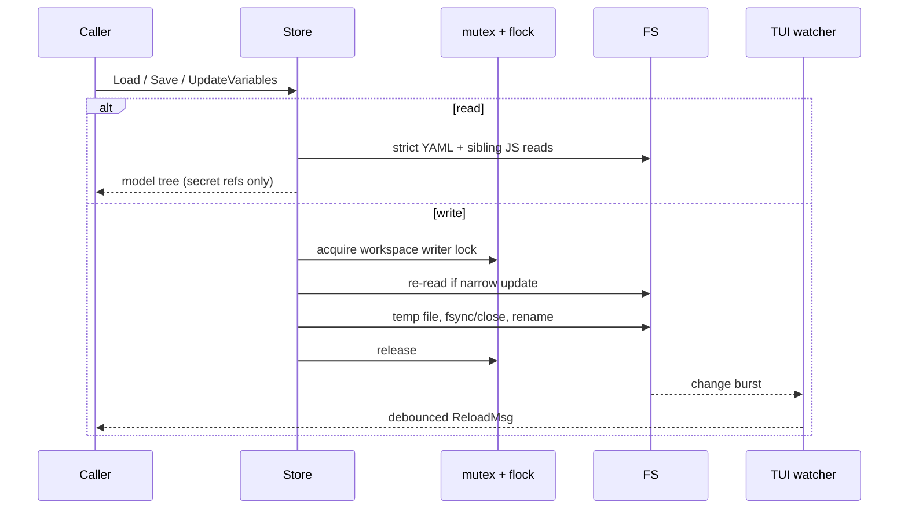

# Flow: workspace storage and reload



## Layout

```text
workspace/
  postctl.yaml
  globals.yaml
  environments/<slug>.yaml
  collections/<slug>/collection.yaml
  collections/<slug>/pre.js, test.js
  collections/<slug>/<NNN>-<request>.yaml
  collections/<slug>/<NNN>-<request>.pre.js, .test.js
  collections/<slug>/<folder>/folder.yaml
  .postctl/state.yaml
  .postctl/cookies.json
  .postctl/store.lock
  .postctl/history/history.jsonl
```

The YAML and `.js` tree is versionable. `.postctl/` is local and gitignored.
Collection/folder `order` lists are authoritative; numeric prefixes provide a
stable fallback. Scripts are real sibling files so editors and Git understand
them.

1. `internal/store/discover.go` `Discover` chooses the root. `Open` requires
   `postctl.yaml`; `internal/store/store.go` `Init` creates an empty workspace,
   collections/environments directories, and `.gitignore`.

2. `internal/store/store.go` `Store.Load` decodes strictly and stops at the
   first `FileError`. `Store.LoadLenient` skips malformed child requests,
   folders, collections, environments, globals or missing script files and
   returns all problems beside the readable tree. Both derive stable IDs for
   hand-written files without IDs. Neither touches Keychain.

3. The loader reads each `collection.yaml` and `folder.yaml`, orders children,
   decodes one request per YAML file, then loads referenced/conventional
   sibling scripts. Strict YAML rejects unknown top-level fields; forward
   compatibility belongs in model `Extra` maps. Schema migrations run before
   decode.

4. `internal/store/save.go` `Store.Save` synchronizes a whole workspace;
   `Store.SaveCollection`, `Store.SaveRequest`, `Store.SaveEnvironment`, and
   `Store.SaveGlobals` are narrower. Saves validate, derive collision-safe
   slugs and order, serialize deterministically, and avoid rewriting identical
   bytes. Whole-collection saves remove only files the store owns.

5. Before serialization, the secret writer copies nodes, sends non-empty
   secret variable values and OAuth token strings through `SecretStore.Set`,
   clears plaintext and writes `secretRef`. Literal auth fields are deliberately
   literal; importer D2 is what moves imported credentials to variables.

6. Every writer uses `internal/store/lock.go` `Store.lock`: a per-root
   process mutex plus advisory flock on `.postctl/store.lock`. File replacement
   uses same-directory temporary files and rename. This prevents partial
   readers and cross-process writer interleaving.

7. Engine script persistence calls
   `internal/store/save.go` `Store.UpdateEnvironmentVariables`,
   `Store.UpdateCollectionVariables`, or `Store.UpdateGlobalsVariables`.
   Each re-reads the latest file while holding the lock, applies only
   `vars.Change` keys, and writes atomically. Thus an in-flight send cannot
   replace unrelated edits from the TUI or another CLI. Same-key writes are
   last-writer-wins.

8. `internal/store/state.go` `Store.SaveState` persists active environment and
   folded nodes. `internal/httpx/cookies.go` `CookieJar.saveLocked` writes the
   mode-0600 cookie file. `internal/history/history.go` `Log.Append` writes a
   redacted JSONL record under a separate history flock and compacts bounds.

9. `internal/tui/watch.go` `newWatcher` uses fsnotify across non-dot
   directories and debounces 250ms bursts. If kqueue cannot cover the tree it
   polls every 2s. Dot files, `.postctl/`, editor backups and store temp files
   are ignored. `internal/tui/app.go` `app.onFSChanged` ignores its own save
   window and otherwise schedules another lenient load; a failed reload keeps
   the last good screen model.

Extension points are `store.Migration`, `SecretStore`, TUI `Backend`, file
kinds and watcher implementations. Preserve deterministic output, atomic
writes, lenient-save protection, and the single workspace lock for any new
writer.
