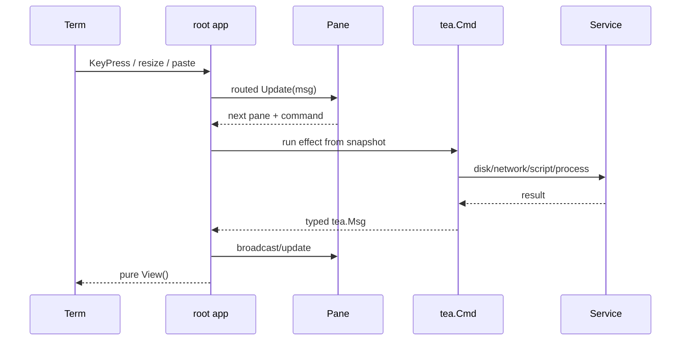

# Flow: TUI input, state and rendering

1. `internal/tui/app.go` `newApp` creates the root model, shared theme, tree,
   key registry, request/response panes and optional request-kind router.
   Shared context is workspace, active environment, current selection, focus,
   overlays, save queue and in-flight sends. Feature panes own their editor or
   viewer state.

2. `internal/tui/app.go` `app.Update` is the only normal mutation path. It
   handles shell messages first, then routes keys through `app.onKey`.
   An open overlay gets input first; active text editing suppresses plain
   global keys; otherwise global routing precedes sidebar or focused pane.
   Non-key typed results are broadcast to both panes so selection, environment,
   send, theme and reload stay synchronized.

3. Focus slots are Collections, Request and Response. `app.setFocus` blurs the
   old pane (flushing autosave when supported), focuses the new one, and
   remembers the right-hand tab. `internal/tui/kindrouter.go` `kindRouter.Update`
   swaps the request slot to the WebSocket pane when the selected request kind
   changes.

4. `internal/ui/theme.go` `LayoutFor` chooses three panes at 140+ columns, two
   panes at 100–139, and one pane below 100. `internal/tui/layout.go`
   `app.geo` assigns widths; `app.layoutPanes` pushes sizes on every resize.
   Accessible mode always uses the linear single-pane layout. A WebSocket owns
   the request/response area in side-by-side layouts.

5. `internal/ui/theme.go` `NewTheme` is the sole source of Clear Signal
   semantic styles and glyph choices. Components request roles, not ad-hoc
   colors. Background-color messages rebuild the theme and broadcast
   `ThemeChangedMsg`. `NO_COLOR`, ASCII and accessible modes preserve labels
   and focus markers without relying on color or Unicode.

6. `internal/tui/keys.go` `newKeyMap` is the shell shortcut registry.
   `internal/tui/help.go` `helpOverlay.view` and footer hints derive from
   bindings and focused pane `KeyHints`; palette actions derive from
   `Registry`. `cmd/genkeys/main.go` `main` owns the generated complete
   `docs/keys.md`. A key change is incomplete until code, tests and
   `go generate ./cmd/genkeys` agree.

7. Overlays implement the small `overlay` interface in
   `internal/tui/overlays.go`; dialogs render over the main body and full
   screens use `screenOverlay`. Screens (environment editor, runner, history,
   cookies) are factories injected through `tui.Options`, so the shell does
   not construct feature dependencies.

8. `internal/tui/layout.go` `app.View` computes a `tea.View` solely from current
   state. It renders header, loading/fatal/first-run/overlay/main body, toast,
   and focused hints. Pane `View` methods must also be pure; tests such as
   `internal/tui/request/pure_view_test.go` fail if a view mutates state.

9. Effects return typed messages. Workspace loading and watchers are commands;
   request saves use the shell save queue; sends use the command/queue described
   in [send-request](send-request.md); external editor, pager, OAuth, curl and
   secret reveal commands operate on snapshots. No goroutine writes a model.

## Adding a pane or screen

1. Implement `internal/tui/pane.go` `Pane` for content that occupies a slot, or
   `internal/tui/pane.go` `Screen` for a temporary full-body workflow.
2. Put blocking dependencies behind a narrow `Deps` interface and return
   typed messages from commands.
3. Register a factory in `tui.Options` and compose it in
   `cmd/postctl/wire.go` `wireEditors`; do not import the feature into lower
   services.
4. Add actions to `Registry`, define bindings once, return contextual
   `KeyHints`, regenerate `docs/keys.md`, and add collision/coverage tests.
5. Test 80×24, 100/140 breakpoints, dark/light, ASCII/no-color/accessibility,
   cancellation, and View purity. Mask secret-bearing display snapshots before
   they reach View; reveal must be an explicit command/state.
